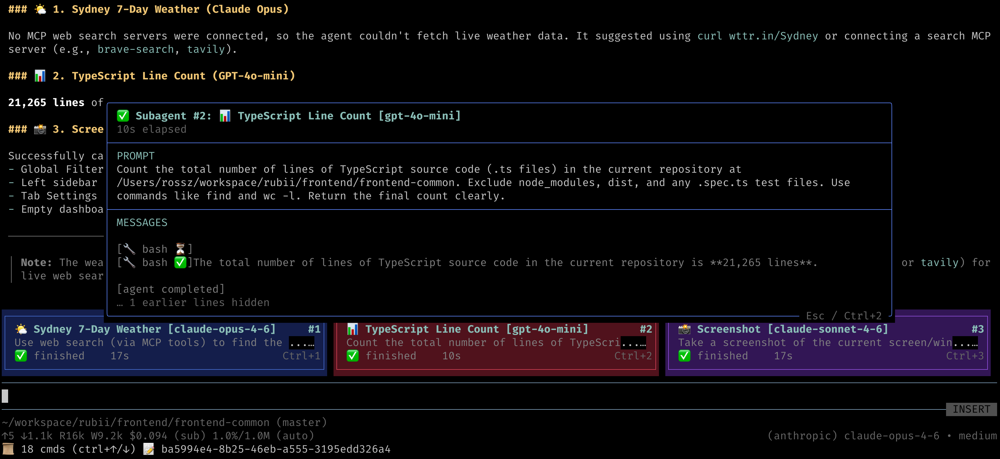

# pi-subagent-in-memory

In-process subagent tool for [pi](https://github.com/nicholasgasior/pi-coding-agent) with live TUI card widgets, JSONL session logging, and **zero system-prompt overhead**.



## Key Design Principle

**This extension adds nothing to your LLM context beyond tool parameter definitions.** No system prompt injection, no hidden instructions, no pre-determined behavior — the LLM only sees the `subagent_create` / `subagent_kill` tool schemas and decides how to use them naturally.

## Features

### 🤖 `subagent_create` Tool

Spawns an in-process subagent session using pi's `createAgentSession` SDK. The subagent runs in the same process (not a subprocess), with its own session, tools, and model. Multiple subagents can run in parallel.

**Tool parameters:**

| Parameter | Type | Required | Description |
|-----------|------|----------|-------------|
| `task` | string | ✅ | The task for the subagent to perform |
| `title` | string | | Display title for the card widget |
| `provider` | string | | LLM provider (e.g. `anthropic`, `google`, `openai`) |
| `model` | string | | Model ID. Supports `provider/model` format (e.g. `openai/gpt-4o-mini`) |
| `thinkingLevel` | string | | Reasoning effort: `off`, `minimal`, `low`, `medium`, `high`, `xhigh`, or `max`. Defaults to `off` |
| `cwd` | string | | Working directory for the subagent |
| `timeout` | number | | Timeout in seconds. Aborts the subagent if exceeded. Defaults to the configured default timeout (1800s, see `/saim-timeout`). Best left unset unless the runtime can be estimated accurately — the schema tells the LLM not to pass small values like `300`, which cut work off unfinished |
| `columnWidthPercent` | number | | Card width as % of terminal (33–100). Controls card grid layout |

If `provider` and `model` are omitted, the subagent inherits the main agent's model.

### 🔪 `subagent_kill` Tool

Stops a stuck subagent immediately instead of waiting for its timeout to expire.

**Tool parameters:**

| Parameter | Type | Required | Description |
|-----------|------|----------|-------------|
| `sessionId` | string | | Session ID of the subagent to kill (the reliable identifier) |
| `num` | number | | Card number shown on the TUI card badge (`#N`). Ignored if `sessionId` is given |
| `reason` | string | | Why it is being killed. Recorded in the subagent's `error.md` |

Called with **no arguments**, it returns the list of running subagents (number, session ID, title, status, elapsed time, output directory) — so the agent can discover what it is allowed to kill and then call again with a `sessionId`.

A killed subagent is finalized exactly like a timed-out one: `error.md`, `partial-result.md` (if it had produced any text), and the full `events.jsonl` are written to its output directory, so its work so far can still be harvested. Nested subagents it spawned are **not** killed — they detach and keep running under their own timeouts.

The typical flow for a stuck subagent: interrupt the turn (the child detaches and its `sessionId` is reported back), then ask the agent to kill it. Nested coordinators get `subagent_kill` too, but scoped: a subagent can only kill subagents at or below the nesting level it spawns — never itself, a peer, or an ancestor.

### ⏱️ Timeouts That Don't Destroy Child Work

Every subagent has a timeout (default **1800s** / 30 min, configurable via `--saim-timeout` / `/saim-timeout`, `0` = unlimited). When a parent agent is aborted or times out while a child subagent is still running, the child is **not killed**. Instead it detaches:

- The parent's tool call returns immediately with a note that the child continues in the background
- The child keeps running, still bounded by its **own** timeout
- When it finishes, its output is written to `result.md` (or `error.md` on failure) as usual, so the work can be harvested later

On any failure (timeout, error), whatever text the subagent had already produced is salvaged to `partial-result.md` alongside `error.md` — nothing is silently discarded. `error.md` also includes a tail of the subagent's recent activity (tool calls, output) and points at `events.jsonl`, so a coordinator can harvest partial findings from a timed-out worker instead of redoing its work.

Subagents that can spawn nested subagents see their **own timeout budget** in the nested `subagent_create` tool description (schema only — still no context injection), so they can size child timeouts to leave room for collecting and integrating results before their own deadline.

### 🛑 Nesting Depth Limit

Subagents may spawn their own subagents, but only up to a configured max depth (default **2**: main agent → subagent → sub-subagent). Subagents at the max depth don't receive the `subagent_create` tool at all, so a runaway fork cascade is structurally impossible. Configure via `--saim-max-depth` / `/saim-max-depth` (1–10).

### 📊 Live TUI Card Widgets

Each running subagent is displayed as a colored card widget above the editor:

- Cards show **title**, **model**, **prompt preview**, **elapsed time**, and **status indicator** (⏳ started, ⚡ working…, ✅ finished, ❌ error)
- The prompt passed to the subagent is displayed as card content, so you can see at a glance what each subagent is doing
- Cards auto-layout into a responsive grid (1–3 columns based on `columnWidthPercent`)
- Subagent number badge (`#1`, `#2`, …) shown on the top-right corner of each card
- Six rotating color themes for visual distinction between cards

### 🔍 Subagent Detail Overlay (`Ctrl+Shift+N`)

Press **Ctrl+Shift+1** through **Ctrl+Shift+9** to open a detail popup for the **N-th visible** subagent card (1 = leftmost/topmost in the current window):

- **Prompt** — Full prompt text with word wrapping (up to 5 lines)
- **Messages** — Live-updating stream of the subagent's activity (text output, tool calls, status changes), always showing the latest 5 lines
- Press the same **Ctrl+Shift+N** shortcut or **Escape** to close the overlay

Plain `Ctrl+<digit>` is deliberately **not** the default: terminal multiplexers and terminal apps (tmux, Herdr, kitty, WezTerm layouts) claim it for their own tabs or spaces and swallow the key before pi sees it. Change the chord in [Keys](#-keys) if you prefer another.

### 📑 Paging Through Cards (`Ctrl+Alt+←/→`)

When more subagents have been spawned than fit in the visible window (see `/saim-set-max-tui-overlays` below):

- **Ctrl+Alt+←** scrolls back to older subagent cards
- **Ctrl+Alt+→** scrolls forward to newer subagent cards
- A `subagents X–Y of N (Ctrl+Alt+←/→ to page)` hint is displayed above the cards whenever paging is active

Both chords are configurable — see [Keys](#-keys).

### 📝 JSONL Session Logging

Every subagent session is logged to disk for debugging and auditing:

```
.pi/subagent-in-memory/<mainSessionId>/
├── subagent_1/
│   ├── events.jsonl        # Full event stream (text, tool calls, results)
│   └── result.md           # Final subagent output
├── subagent_2/
│   ├── events.jsonl
│   ├── error.md            # On failure: what went wrong
│   └── partial-result.md   # On failure: any text produced before the failure
└── ...
```

The JSONL log includes:
- Session metadata (model, provider, task, cwd)
- Aggregated text output (deltas combined into single entries)
- Tool call arguments and results
- Timestamps and parent event IDs for tracing

### 🔄 Nested Subagent Support

Subagents can spawn their own subagents, up to the configured max depth (see above). All nested cards render in the main agent's widget — they share the same module-level state regardless of nesting depth. This is achieved by passing the `subagent_create` tool directly as an `AgentTool` to child sessions.

### ⌨️ Keys

The TUI shortcuts are set in `<agent dir>/subagent-in-memory.json` —
`~/.pi/agent/subagent-in-memory.json` unless `PI_CODING_AGENT_DIR` says
otherwise. Every field is optional:

```json
{
  "inspectModifier": "ctrl+shift",
  "pageOlderKey": "ctrl+alt+left",
  "pageNewerKey": "ctrl+alt+right"
}
```

| Field | Default | Meaning |
|-------|---------|---------|
| `inspectModifier` | `ctrl+shift` | Modifier prefix for the numbered inspect shortcuts. `"ctrl+shift"` binds `ctrl+shift+1` … `ctrl+shift+9`. Set `"alt"` for `alt+1`…`alt+9`, or `"off"` to leave the digits to the terminal. |
| `pageOlderKey` | `ctrl+alt+left` | Page to older cards. |
| `pageNewerKey` | `ctrl+alt+right` | Page to newer cards. |

Rules the loader enforces, so a typo is reported instead of leaving a
shortcut silently dead:

- Modifiers are `ctrl`, `shift`, `alt` and `super`, in any order, each at most once. Modifier order is normalised, so `shift+ctrl` and `ctrl+shift` are the same binding.
- `inspectModifier` needs `ctrl`, `alt` or `super`: `shift` alone would capture plain shifted digits.
- Paging keys need at least one modifier and a known key name (`left`, `pageup`, `f5`, `a`, `1`, …).
- `"inspectModifier": "off"` (also `"none"`, `"false"`, `""`) unbinds the inspect shortcuts entirely.

The file is read when the extension loads, because pi registers extension
shortcuts before the session exists — edit it and run `/reload`. Run
`/saim-keys` to see the resolved bindings, the file path and any problems.

```text
/saim-keys
→ Config: ~/.pi/agent/subagent-in-memory.json
→ inspectModifier: ctrl+shift  →  Ctrl+Shift+1 … Ctrl+Shift+9
→ pageOlderKey: ctrl+alt+left  →  Ctrl+Alt+←
→ pageNewerKey: ctrl+alt+right  →  Ctrl+Alt+→
```

### 🎛️ Slash Commands

| Command | Description |
|---------|-------------|
| `/saim-max-depth [n]` | Show or set the max subagent nesting depth (1–10, default 2). Applies to newly created subagents. |
| `/saim-timeout [seconds]` | Show or set the default subagent timeout in seconds (default 1800, `0` = unlimited). A per-call `timeout` parameter overrides it. |
| `/saim-toggle-overlay [on\|off\|toggle]` | Enable, disable, or toggle the subagent TUI overlay. When disabled, **no card widget is mounted even while subagents are actively running** — they continue executing silently in the background. |
| `/saim-set-max-tui-overlays <N>` | Set the maximum number of cards displayed at once (1–9, default 3). Older cards remain accessible via **Ctrl+Alt+←/→**. |
| `/saim-keys` | Show the resolved key bindings, the config file path, and any problems in it. Restart with `/reload` after editing the file. |
| `/saim-clear-tui-overlay` | Clear all subagent cards from the TUI and close any open detail overlay. |

### 🚩 CLI Flags

| Flag | Description |
|------|-------------|
| `--saim-max-depth <n>` | Max subagent nesting depth (1–10, default 2). Same as `/saim-max-depth`. |
| `--saim-timeout <seconds>` | Default subagent timeout in seconds (default 1800, `0` = unlimited). Same as `/saim-timeout`. |
| `--saim-no-tui` | Start with the subagent overlay disabled (equivalent to running `/saim-toggle-overlay off` immediately on startup). Subagents still run normally — only the TUI cards are hidden. |

## Install

```bash
pi install npm:pi-subagent-in-memory
```

## Remove

```bash
pi remove npm:pi-subagent-in-memory
```

## Verify Installation

After installing, start pi and check:

1. The `subagent_create` and `subagent_kill` tools should appear in the tool list
2. The `/saim-max-depth`, `/saim-timeout`, `/saim-toggle-overlay`, `/saim-set-max-tui-overlays`, and `/saim-clear-tui-overlay` commands should be available (type `/` to see commands)
3. Ask the agent to "run a subagent to list files" — you should see a card widget appear

## Usage Examples

Once installed, the LLM will discover the `subagent_create` tool from its schema and use it when appropriate. Some natural prompts:

```
# Single subagent
"Spawn a subagent to analyze the test coverage in this repo"

# Parallel subagents
"Run 2 subagents in parallel: one to summarize src/ and another to summarize tests/"

# Different models and reasoning effort
"Use a subagent with openai/gpt-4o-mini and medium thinking to review the README"

# With timeout
"Spawn a subagent with a 60-second timeout to count lines of code"

# Custom working directory
"Run a subagent in /tmp to check disk space"

# Killing a stuck subagent (after interrupting the turn, so it detached)
"List the running subagents and kill the one that's stuck"
```

## How It Works

1. **Tool registration** — On load, registers `subagent_create` and `subagent_kill` as tools plus the `/saim-*` commands and `--saim-no-tui` flag. No system prompt modifications.
2. **Session creation** — When the LLM calls `subagent_create`, a new `createAgentSession` is created in-process with its own model, auth, and coding tools (read, write, edit, bash, grep, find, ls).
3. **Event streaming** — All subagent events (text deltas, tool calls, completions) are forwarded as `tool_execution_update` events to the parent agent and logged to JSONL.
4. **Widget rendering** — A TUI widget renders card(s) above the editor, updated on every event.
5. **Result handoff** — The final text output is written to `result.md`. The parent agent receives a short pointer path, not the full content, keeping context lean.

## Requirements

- [pi](https://github.com/nicholasgasior/pi-coding-agent) (peer dependency)
- API keys configured for any providers you want subagents to use (via `pi login` or environment variables)

## Known Limitations

- **`openai-codex` subagents can hang the parent session (pi 0.8x).** Running a second
  `openai-codex` session in the same process leaves the *parent* session's next request
  hanging indefinitely — the subagent itself completes and writes its `result.md` normally.
  This reproduces with both the `websocket` and `sse` transports, so it appears to be
  per-account state on the ChatGPT backend rather than a transport bug in pi. Until fixed
  upstream, pass a different provider/model to subagents when your main agent runs on
  `openai-codex` (e.g. `provider: "xai", model: "grok-4.5"`). The extension prints a
  warning when a codex subagent is spawned.

## License

MIT
